<p align="center">
  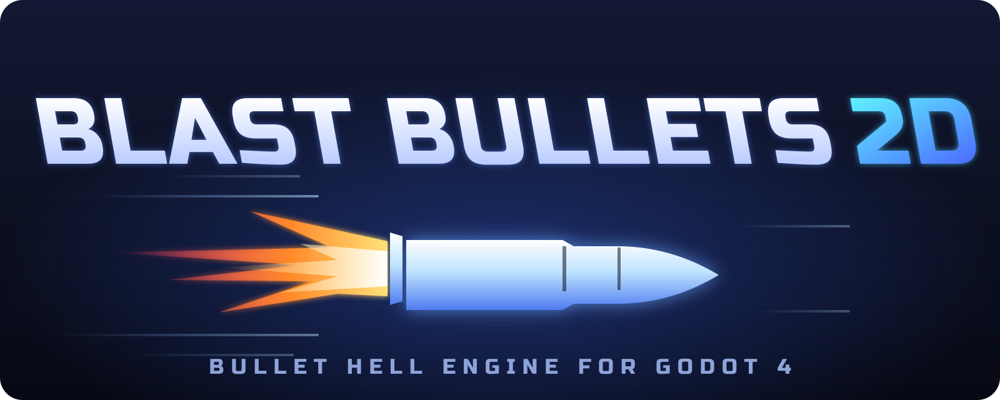
</p>

<p align="center">
  <b>The bullet hell plugin for Godot 4: thousands of bullets, lasers and danmaku patterns, written in C++, driven from GDScript.</b><br>
  For shmups, bullet hells, twin-stick and top-down shooters. Free, open source (MIT), no C++ knowledge needed.
</p>

<p align="center">
  <a href="https://github.com/nikoladevelops/godot-blast-bullets-2d/actions/workflows/tests.yml"></a>
  <a href="https://github.com/nikoladevelops/godot-blast-bullets-2d/releases"></a>
  
  
</p>

<p align="center">
  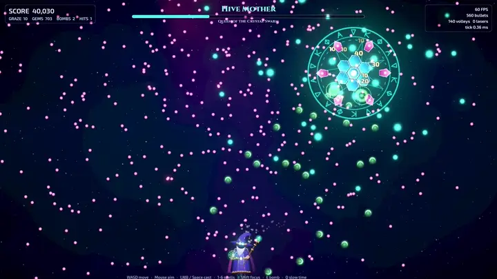
</p>

**Contents:** [Why](#why-blastbullets2d) · [Made for](#made-for) · [See it in action](#see-it-in-action) · [Examples](#learn-from-the-examples) · [Install](#install) · [Your first boss in 5 minutes](#your-first-boss-in-5-minutes-no-code) · [Handle hits](#handle-hits) · [Recipes](#recipes) · [Spawning from code](#spawning-from-code) · [Performance](#performance) · [Limits](#limits) · [Multiplayer status](#multiplayer-status) · [Rules worth knowing](#rules-worth-knowing) · [Reference](#reference) · [Building and testing](#building-from-source-and-running-the-tests)

## Why BlastBullets2D

BlastBullets2D is a GDExtension projectile system for Godot 4: a bullet spawner, a pattern generator and a pooled bullet engine for 2D games with a lot of projectiles.

- **Fast.** One volley is one MultiMesh draw and one physics area, not one node per bullet. 10,000 flying bullets cost about **0.3 ms** per physics tick, and 8 auto-firing bosses with homing, splitting and graze keeping ~10,000 bullets alive about **0.5 ms** (Ryzen 7 8840HS, the shipped release build). Volleys, lasers and attachments are pooled automatically.
- **Patterns without math.** `BulletSpawner2D` has **33 pattern sources** (ring, fan, spiral, flower, rose, star, heart, rain, walls with gaps, Lissajous, any `Path2D`, your own markers...) with a **live preview in the editor**, 20 one-click presets, spin, bursts, telegraphs, fire budgets and boss phase sequences.
- **Every bullet-hell system, already integrated:** homing and orbiting, bouncing, curves, wobble, gravity, `Path2D` movement patterns, graze (near misses), boids flocking, bullets that split, bullets that fire bullets, lasers (beams, bolts, curvy snakes), bullets that turn into coins, a sound mixer, slow motion, per-bullet colors and lifetimes, animated `SpriteFrames` art, particles that follow bullets.
- **Safe to use.** Every signal fires while the bullet is still alive (read it, heal it, split it), handlers may free anything, and wrong settings fail loudly with a message that says what to fix. Every feature is covered by an automated test suite (more than 2,700 tests) that also runs on the release build, under memory and undefined-behavior sanitizers, and under seeded fuzzing.
- **Documented in the editor.** Every class, property, method and signal has in-editor help (<kbd>F1</kbd> or Ctrl+click), and the inspector warns about missing setup.
- **Every platform:** Windows, macOS, Linux, Android, iOS and Web, prebuilt.

## Made for

- **Bullet hell and danmaku** games: boss patterns, spell cards, graze scoring, bombs that clear the screen.
- **Shoot 'em ups (shmups)**, vertical or horizontal scrollers.
- **Twin-stick and top-down shooters**, arena shooters and survivor-likes (auto-fire weapons, thousands of enemy projectiles, pickups that fly to the player).
- **Tower defense and action roguelites** that need many projectiles, homing missiles, lasers and splitting shots.

Less of a fit: games that Y-sort every projectile between characters (see [Limits](#limits)), projectiles that must push rigid bodies, and 3D games.

**Videos:** [Trailer](https://www.youtube.com/watch?v=OJK7201pzsE) · [Features showcase](https://www.youtube.com/watch?v=SeyD1YVIZss) · [Tutorial part 1](https://www.youtube.com/watch?v=L10sHF4BnLs) · [Tutorial part 2](https://www.youtube.com/watch?v=R2olIyF7aPQ)

## See it in action

Every clip and screenshot below is **Arcane Barrage**, a complete bullet-hell game built only with the plugin's nodes and resources: a wizard against four bosses, six spells, graze scoring, bombs that turn bullets into gems and a 16,000-bullet stress test.

| | |
|---|---|
| 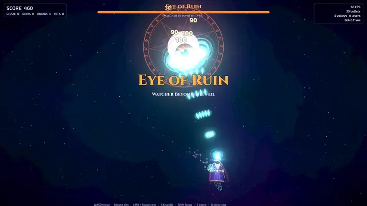<br>**Lasers:** charged beams that sweep, lock-on and curvy snakes | 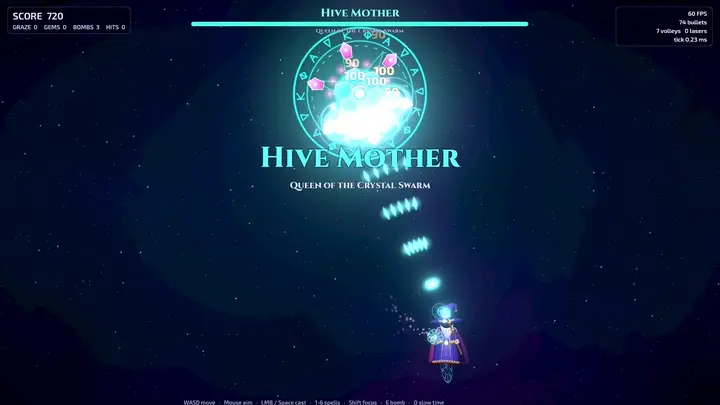<br>**Homing and flocking:** a swarm that hunts but keeps its distance |
| 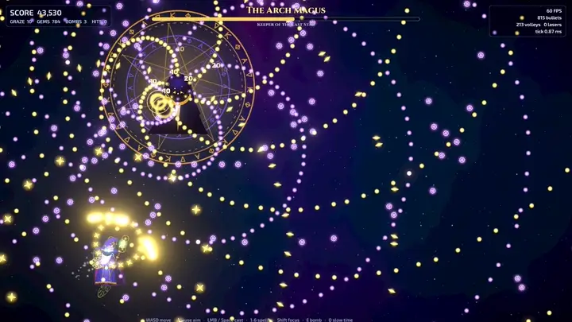<br>**Spin, emitters and orbiting:** bullets that fire bullets, cages that circle you | 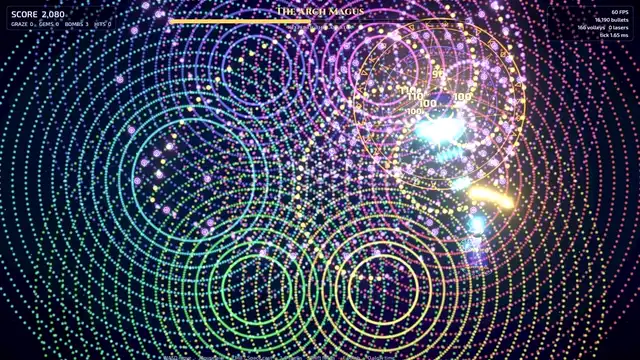<br>**16,000 bullets** with the boss fight running, still at a steady 60 FPS |

| | | |
|---|---|---|
| 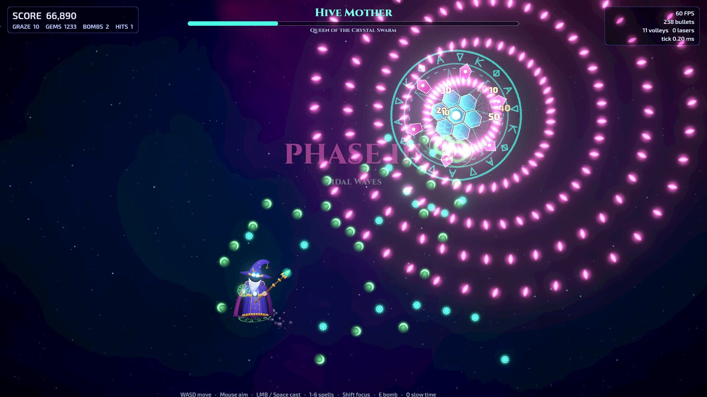 | 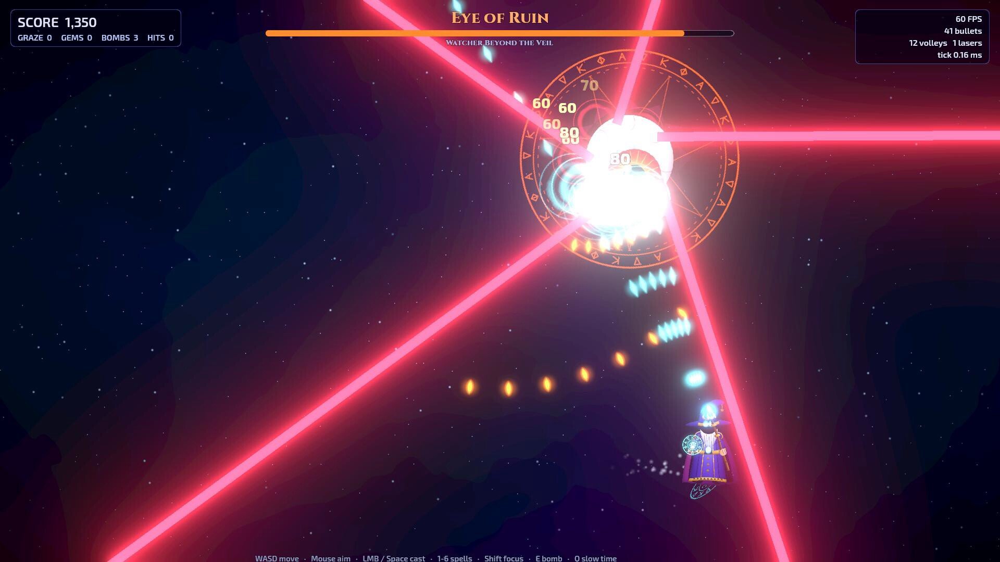 | 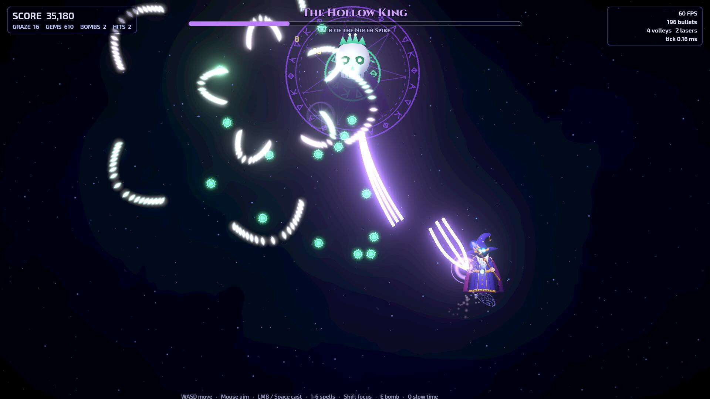 |
| 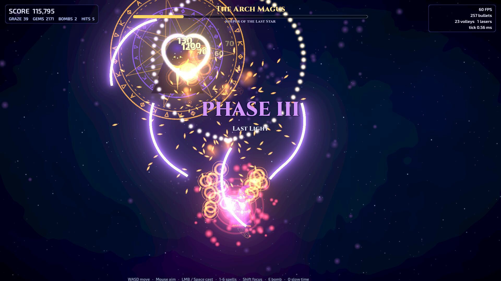 | 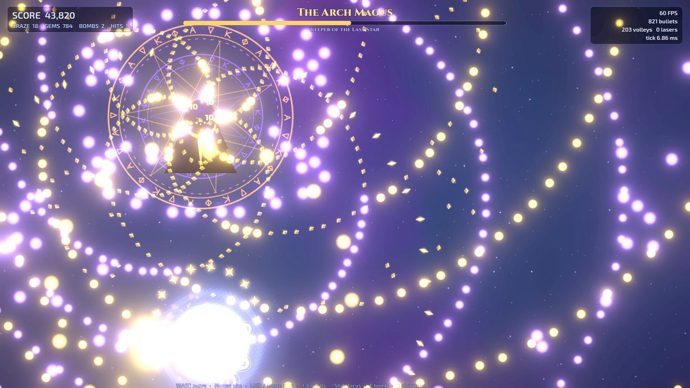 | 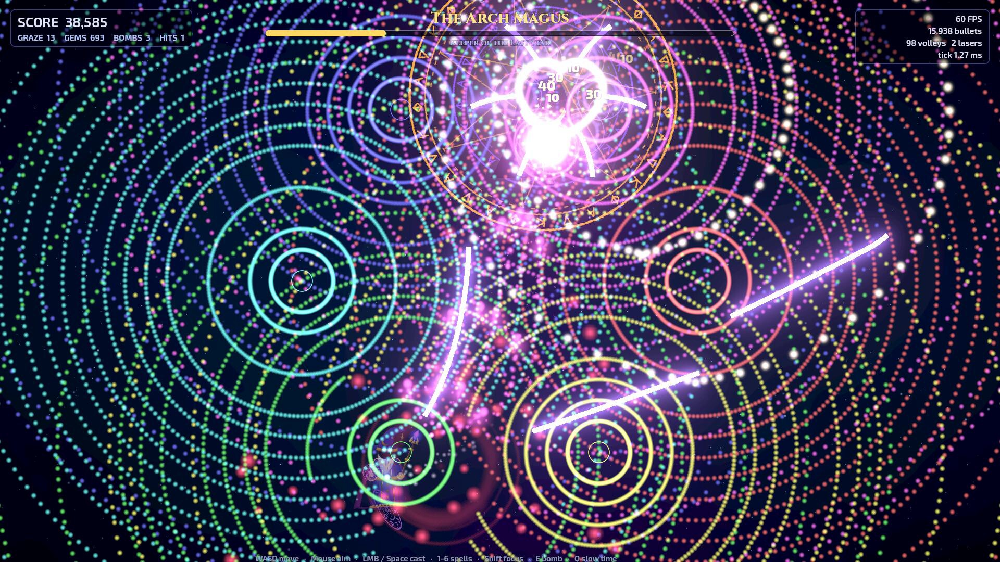 |

**Get the whole game:** the complete Arcane Barrage project (every boss, attack and spell as short, commented code, plus its art, music and sound) is a thank-you for supporters on [Ko-fi](https://ko-fi.com/realnikich) and [Patreon](https://patreon.com/realnikich). Open it to see how a full bullet hell is put together with the plugin.

## Learn from the examples

[`test_project/examples/`](test_project/examples) holds six small scenes, each a few nodes and one short script. Open `test_project/` in Godot, open a scene and press <kbd>F6</kbd>:

| Scene | Shows |
|---|---|
| `01_ring_turret` | a spinning ring pattern set up entirely in the inspector, and reacting to hits |
| `02_homing` | bullets that chase the player, retargeted to the mouse while you hold the button |
| `03_graze_score` | points for near misses with a two-ring graze zone |
| `04_laser` | a charging beam that sweeps the arena |
| `05_split` | slow orbs that burst into rings of small bullets |
| `06_boss_phases` | a boss that changes its attack at half health, and your ship's gun hitting it |

The rest of `test_project/` is the test lab: a scene with a sidebar to try every feature live (bullet counts, collision, pools, physics rates), and the automated test suites. Press <kbd>F2</kbd> in the test lab or in any example to open the **live inspector**: every property of the factory, the spawners, their spawn and laser data and any nested resource, edited while the game runs (a refused value keeps the old one and says so), plus a button for every argument-free method.

## Install

Requires **Godot 4.5 or newer** (tested on 4.7).

1. Download `blastbullets2d.zip` from the [latest release](https://github.com/nikoladevelops/godot-blast-bullets-2d/releases) (also on the [Godot Asset Library](https://godotengine.org/asset-library/asset/2632) and [itch.io](https://realnikich.itch.io/blastbullets2d)).
2. Extract it and copy the `blastbullets2d` folder anywhere into your project (for example `res://addons/blastbullets2d`).
3. Restart the editor. `BulletFactory2D`, `BulletSpawner2D` and `LaserSpawner2D` now appear in the **Add Node** dialog.

There is no plugin to enable: it is a GDExtension and loads by itself.

## Your first boss in 5 minutes (no code)

You need three things:

| What | Job | How many |
|---|---|---|
| `BulletFactory2D` (node) | Owns every bullet: pooling, physics, drawing, signals | One per level |
| `BulletSpawner2D` (node) | Decides **where** and **when** bullets spawn (pattern, fire rate, spin...) | One per gun, turret or boss |
| `BulletVolleyData2D` (resource) | Decides **what** a bullet is (art, speed, hitbox, lifetime) | One per bullet type |

1. **Add a `BulletFactory2D`** to your level scene.
2. **Add a `BulletSpawner2D`** (as a child of your boss, or anywhere). It finds the factory by itself.
3. **Give it bullets:** in the inspector, **Setup → Spawn Data → New BulletVolleyData2D**, then open it and set:
   - **Appearance → Sprite Frames:** a `SpriteFrames` with your bullet art. Draw bullets **facing right**.
   - **Movement Speed → Shared Bullet Speed Data → New BulletSpeedData2D**, and set its **Speed** (try `200`). *Speed defaults to 0: without this the bullets stand still.*
   - **Collision → Collision Shape** (a `CircleShape2D` is the cheapest), plus **Collision Layer** and **Collision Mask** (what the bullets are, and what they hit).
4. **Pick a pattern:** **Patterns → Pattern Source → Spiral** (or any other) and set **Helper Bullets Amount**. The editor draws a dot and an arrow for every bullet that will spawn.
5. **Press play.** The spawner fires once per second (**Shooting → Shoot Interval Sec**).

> **Faster start:** select the spawner and run `apply_pattern_preset(BulletPatterns2D.PATTERN_PRESET_SPIRAL_3ARM)` from a script, or browse the presets in code completion. They set the pattern knobs for you; tune from there.

Nothing appears? Look at the warning icon on the spawner node: it says what is missing. At runtime, `print($BulletSpawner2D.get_setup_warnings())` returns the same list, and the spawner's `volley_skipped(reason)` signal tells you why a shot did not fire.

## Handle hits

Bullets report what they hit through signals, **while the bullet is still alive**: inside the handler you can read its position, velocity and custom data, and even save it.

### Where to connect: factory or spawner

Every hit is reported **exactly once**, on one of two nodes:

| Connect on | Receives | Use it for |
|---|---|---|
| **The factory** (recommended default) | the hits of every bullet in the game: volleys from `factory.spawn_volley`, split children, pickups, bullets of a dead enemy (`orphaned_volleys` = Hand To Factory, the default), **and** every spawner that has no handler of its own for that signal | damage, score, hit sparks: rules that are the same for all bullets. One handler, connected once, never misses a bullet |
| **A spawner** | the hits of the bullets **that spawner** fired | one attack that behaves differently (this boss's ice shots freeze, this turret's bullets heal allies) |

A spawner with a handler **takes its hits away from the factory**: they are never reported twice. The choice is per signal: a spawner handling only `area_entered` still lets its `body_entered` go to the factory. So: put your general rules on the factory, and connect a spawner only where an attack needs its own behavior. Lasers follow the same rule (`laser_hit`, ...); graze is the one exception and always reaches the factory too.

### Damage per bullet type: custom data

Give bullets your own `Resource` (damage, element, owner team, ...) and read it in the handler:

```gdscript
extends Resource
# bullet_damage.gd: your own data type. Save instances as .tres files.
@export var amount := 10
@export var element := &"fire"
```

- **Shared Bullets Custom Data** (spawn data, Collision group): one value for every bullet of the volley. Read it with `volley.shared_bullets_custom_data`.
- **All Bullets Custom Data**: one value per bullet (entry `i` belongs to bullet `i`). Read it with `volley.bullet_get_custom_data(bullet_index)`, change it at runtime with `bullet_set_custom_data`.
- The two never fall back to each other: `bullet_get_custom_data` returns `null` for a bullet without its own entry. The helper below reads the bullet's own data first, then the shared one.

```gdscript
extends Node2D

@onready var bullets: BulletFactory2D = $BulletFactory2D

func _ready() -> void:
	bullets.area_entered.connect(_on_bullet_hit)   # Area2D hurtboxes (recommended)
	bullets.body_entered.connect(_on_bullet_hit)   # physics bodies: needs Collision > Monitorable on

func _on_bullet_hit(target: Object, volley: BulletVolley2D, bullet_index: int) -> void:
	var damage := bullet_data(volley, bullet_index)
	if damage != null and target.has_method("take_damage"):
		target.take_damage(damage.amount, damage.element)
	print("hit at ", volley.get_bullet_transform(bullet_index).origin)

## The bullet's own custom data, else the volley's shared custom data.
func bullet_data(volley: BulletVolley2D, bullet_index: int) -> Resource:
	var own: Resource = volley.bullet_get_custom_data(bullet_index)
	return own if own != null else volley.shared_bullets_custom_data
```

A spawner handler for one special attack takes the same arguments: `$Boss/IceGun.area_entered.connect(_on_ice_hit)`.

### Piercing and surviving a hit

- A bullet dies after **Collision → Bullet Max Collision Count** hits (default 1). `0` pierces forever. `volley.get_bullet_collision_count(bullet_index)` tells how many it has taken.
- Whether it dies is decided **after** your handler: `volley.set_bullet_collision_count(bullet_index, 0)` in the handler lets it survive this hit (a shield that reflects, a bullet that passes through allies).
- Want the bullet gone right away? `volley.disable_bullet(bullet_index)`.

## Recipes

Every snippet assumes `spawner` is a `BulletSpawner2D`, `factory` your `BulletFactory2D` and `player` a `Node2D` of yours. Each property is also in the inspector under the group named in the heading.

<details open>
<summary><b>Aim, spin, bursts and warnings</b> (Patterns, Spin, Shooting)</summary>

```gdscript
spawner.pattern_source = BulletSpawner2D.PATTERN_FROM_HELPER_AIMED
spawner.helper_aimed_target = spawner.get_path_to(player)   # aims a cone at the player, with lead
spawner.spin_enabled = true                                # turn the whole pattern while firing
spawner.spin_speed_deg_per_sec = 90.0
spawner.burst_enabled = true                               # 3 quick shots, then a pause
spawner.burst_count = 3
spawner.burst_interval_sec = 0.1
spawner.telegraph_enabled = true                           # volley_telegraphed fires 0.5 s before each shot
spawner.telegraph_sec = 0.5
spawner.max_live_bullets = 400                             # skip shots while 400 of its bullets fly
```
</details>

<details>
<summary><b>Homing bullets</b> (Homing, Orbiting)</summary>

```gdscript
player.add_to_group(&"player")
spawner.homing_enabled = true
spawner.homing_target_source = BulletSpawner2D.HOMING_SOURCE_NODE_GROUP
spawner.homing_node_group = &"player"
spawner.homing_smoothing = 4.0         # 0 snaps, higher turns more gently
spawner.homing_duration_sec = 2.0      # stop steering after 2 s (0 = forever)
spawner.home_live_volleys_to(player)   # re-aim bullets already flying

spawner.orbiting_enabled = true        # circle the target instead of hitting it...
spawner.orbiting_radius = 120.0        # ...on a 120 px ring (orbiting_direction: left, right, random or escort)
```
Orbiting uses the same targets as homing. `print("\n".join(spawner.debug_explain_features()))` explains in plain sentences what homing, orbiting and flocking will do with the current settings.
</details>

<details>
<summary><b>A moving spawner: a boss that strafes</b> (Movement)</summary>

The spawner travels along any `Path2D` while it fires, and its bullets inherit its motion.

```gdscript
spawner.movement_enabled = true
spawner.set_movement_path_node($StrafePath)            # any Path2D with a curve
spawner.movement_timing = BulletSpawner2D.MOVEMENT_TIMING_SPEED
spawner.movement_speed = 180.0                          # px/s along the path (or MOVEMENT_TIMING_DURATION + movement_duration_sec)
spawner.movement_loop_mode = BulletSpawner2D.MOVEMENT_LOOP_PING_PONG   # or ONCE, LOOP
spawner.movement_endpoint_pause_sec = 0.5               # rest at each end
spawner.movement_velocity_inherit_factor = 1.0          # bullets keep the boss's momentum (0 = none)
spawner.movement_play()                                 # also movement_pause/stop/reverse/seek; movement_autostart plays on _ready
spawner.teleport(Vector2(640, 120))                     # jump without a velocity kick
```
Easing (`movement_transition`, `movement_ease`, `movement_progress_curve`) and `movement_rotate_with_path` are in the same group.
</details>

<details>
<summary><b>Bullet motion: speed, curves, rotation, wobble, gravity</b> (spawn data)</summary>

Motion lives on the spawn data (`BulletVolleyData2D`, the spawner's `spawn_data`). Each part takes one `shared_bullet_*` value for every bullet, or an `all_bullet_*` array with one entry per bullet.

```gdscript
var data: BulletVolleyData2D = spawner.spawn_data.duplicate()

var speed := BulletSpeedData2D.new()     # start slow, then accelerate
speed.speed = 120.0
speed.acceleration = 400.0               # px/s gained per second
speed.max_speed = 600.0
data.shared_bullet_speed_data = speed

var curves := BulletCurvesData2D.new()   # or shape speed over the bullet's life with a Curve
curves.movement_speed_curve = preload("res://curves/burst_then_glide.tres")   # x: 0..1 of max_life_time
data.shared_bullet_curves_data = curves  # direction and gravity curves live here too

var spin := BulletRotationData2D.new()   # the sprite turns...
spin.rotation_speed = PI                 # rad/s
data.shared_bullet_rotation_data = spin
data.rotate_only_textures = false               # the whole bullet turns, not just its sprite...
data.adjust_direction_based_on_rotation = true   # ...and the flight follows it: curving bullets

var wobble := BulletWobbleData2D.new()   # weave side to side while flying straight on
wobble.enabled = true                    # off by default
wobble.amplitude = 20.0                  # how strongly it weaves (degrees in WOBBLE_ANGULAR mode)
wobble.frequency_hz = 3.0
data.shared_bullet_wobble_data = wobble

data.gravity = Vector2(0, 400)           # arcs (side view); gravity_delay_sec waits before it pulls
spawner.spawn_data = data
```
Bullets already flying are steered from code with `BulletVolley2D` (`all_bullets_set_speed`, `bullet_set_velocity`, `set_bullet_rotation_data`, ...).
</details>

<details>
<summary><b>Graze (near misses)</b> (Graze)</summary>

Create a `GrazeZone2D` resource (one to four ring radii around the player), then:

```gdscript
spawner.graze_enabled = true
spawner.graze_zones = [preload("res://graze_zone.tres")]
spawner.graze_node_group = &"player"          # who can be grazed
factory.bullet_grazed.connect(func(target, volley, bullet_index, zone, ring_index):
	score += 10 * (ring_index + 1))
```
Graze always reaches the factory too, so one handler counts every graze in the game, even of enemies that already died. The editor draws the rings around your player.
</details>

<details>
<summary><b>Lasers</b> (LaserSpawner2D)</summary>

Add a `LaserSpawner2D`: it has every pattern, timing, spin and movement setting of `BulletSpawner2D` and fires one laser per pattern slot. Pick a **Laser Data** preset in the inspector, or in code:

```gdscript
var lasers: LaserSpawner2D = $Boss/LaserSpawner2D
var laser := LaserData2D.create_preset(LaserData2D.PRESET_CHARGED_SWEEP)
laser.collision_mask = 2                # what it hurts
laser.wall_mask = 1                     # what stops it
laser.hit_interval_sec = 0.1            # laser_hit repeats while a target stays in the beam
lasers.laser_data = laser
lasers.laser_hit.connect(func(target, laser_volley, beam_index, hit_position):
	if target.has_method("take_damage"):
		target.take_damage(2))
```
Presets: instant beam, charged sweep, wall beam, reflecting beam, bolt, homing curvy laser, lock-on.
</details>

<details>
<summary><b>Coins and slow motion</b> (World controls, pickups)</summary>

```gdscript
var coin := BulletPickupData2D.new()
coin.sprite_frames = preload("res://coin_frames.tres")
coin.value = 1
factory.pickup_collected.connect(func(target, at, volley, bullet_index, value):
	score += value)
factory.convert_all_bullets_to_pickups(coin, player)   # a bomb: every bullet becomes a coin flying to the player

factory.time_scale = 0.3                               # slow motion for every bullet, spawner and effect
spawner.time_scale = 0.5                               # this spawner even slower (0.3 x 0.5)
factory.clear_active_bullets()                         # wipe the screen (player death, phase change)
```
</details>

<details>
<summary><b>Bombs, clears and dodging</b> (World controls)</summary>

```gdscript
# can_hit_mask picks bullets (and lasers) by what they can hit: pass the player's
# collision layer to take only what can hurt the player and spare the player's shots.
const PLAYER_LAYER := 1
factory.clear_bullets_in_circle(player.global_position, 160.0, PLAYER_LAYER)   # a hurt-flash clear
factory.convert_all_bullets_to_pickups(coin, player, PLAYER_LAYER)             # a bomb: bullets become coins
factory.end_lasers_in_rect(get_viewport_rect(), true, PLAYER_LAYER)            # and enemy beams fade out
# Cheap enough every frame: where the dangerous bullets are, and the closest one.
for p in factory.get_bullet_positions_in_circle(player.global_position, 120.0, PLAYER_LAYER):
	pass   # push your dodge AI away from p
var nearest := factory.get_nearest_bullet(player.global_position, 300.0, PLAYER_LAYER)
if not nearest.is_empty():
	print("closest danger at ", nearest["position"])
```
</details>

<details>
<summary><b>Bullets that fire bullets, split or flock</b> (Emitter Bullets, Splitting, Flocking)</summary>

```gdscript
# Every bullet of `spawner` fires the whole pattern of `sparks` while it flies.
sparks.shooting_enabled = false                        # sparks only fires from the bullets
spawner.emitter = BulletEmitterData2D.new()            # interval, delay, shot limit, spin per shot
spawner.emitter_spawner_path = spawner.get_path_to(sparks)   # a LaserSpawner2D works too
spawner.emitter_enabled = true

spawner.split_enabled = true                           # bullets burst into children when they die
spawner.split_data = BulletSplitData2D.create_preset(BulletSplitData2D.PRESET_BURST_RING)

spawner.flock_enabled = true                           # boids: bullets swarm and keep their distance
```
</details>

<details>
<summary><b>Boss phases</b> (pattern lists)</summary>

```gdscript
spawner.pattern_list_finished.connect(_next_phase)
spawner.spawn_pattern_list([
	{"preset": BulletPatterns2D.PATTERN_PRESET_RADIAL_DENSE},
	{"preset": BulletPatterns2D.PATTERN_PRESET_SPIRAL_3ARM, "helper_bullets_amount": 30},
	{"pattern_source": BulletSpawner2D.PATTERN_FROM_HELPER_FAN, "helper_bullets_amount": 12},
], false, 0.5)                                         # one entry every 0.5 s
spawner.shoot_once_with({"helper_bullets_amount": 64})  # one special shot; settings restored after
```
</details>

<details>
<summary><b>Bounce off walls and read the normal</b> (Bounce and Ricochet)</summary>

```gdscript
var data: BulletVolleyData2D = spawner.spawn_data    # the spawner's spawn data (duplicate it first if shared)
data.set_bounce_mask_from_array([1])                 # walls on layer 1; must also be in the collision mask
data.set_collision_mask_from_array([1, 2])
data.bounce_mode = BulletVolleyData2D.BOUNCE_PRECISE_SHAPE   # flat walls reflect flat
data.bounce_max_count = 3                            # 0 = unlimited

spawner.bounce_body_entered.connect(func(wall, volley: BulletVolley2D, i: int) -> void:
	var normal := volley.bullet_get_last_bounce_normal(i)   # points away from the wall
	spawn_spark(volley.get_bullet_transform(i).origin, normal))
```
</details>

<details>
<summary><b>Sound effects</b> (Sound)</summary>

A `BulletSoundData2D` says WHEN it plays (`trigger`) and HOW. Give a spawner a list of them (`sound_effects`), arm a volley you spawned yourself (`volley.sound_set_effects(...)`), or play one anywhere (`factory.play_sound(...)`). Every play goes through the factory's mixer: limits, stealing and ducking are shared by everyone using the same resource, and when too many events fire at once the nearest win.

```gdscript
# Hits: five variations, never the same one twice in a row, a little pitch and volume variety.
var hit := BulletSoundData2D.new()
hit.trigger = BulletSoundData2D.SOUND_ON_HIT     # also On Shot, Bounce, Graze, Flight, Split, Lifetime Over, Despawn...
hit.streams = [preload("res://sfx/hit_1.wav"), preload("res://sfx/hit_2.wav"), preload("res://sfx/hit_3.wav")]
hit.stream_mode = BulletSoundData2D.STREAM_RANDOM   # or WEIGHTED (stream_weights), SEQUENCE, SHUFFLE
hit.random_pitch_min = 0.9                          # each play: pitch x a roll in 0.9..1.1
hit.random_pitch_max = 1.1
hit.random_volume_min_db = -3.0                     # each play: volume + a roll in -3..0 dB
hit.max_voices = 6                                  # at most 6 at once across the whole game...
hit.min_interval_sec = 0.04                         # ...and one new play per 40 ms (a 300-bullet hit storm stays one sound)
hit.when_limit_reached = BulletSoundData2D.SOUND_LIMIT_REPLACE_OLDEST   # or SOUND_LIMIT_SKIP_NEW
hit.bus = &"SFX"

# A hum that rides each bullet and fades out when the bullet ends.
var hum := BulletSoundData2D.new()
hum.trigger = BulletSoundData2D.SOUND_ON_FLIGHT
hum.streams = [preload("res://sfx/hum_loop.ogg")]
hum.follow_bullet = true
hum.fade_out_sec = 0.2
hum.max_distance = 600.0          # silent (no voice taken) past 600 px from the listener

# The boss's big shot ducks everything quieter while it plays.
var boom := BulletSoundData2D.new()
boom.trigger = BulletSoundData2D.SOUND_ON_SHOT
boom.streams = [preload("res://sfx/boom.wav")]
boom.priority = 10
boom.duck_amount_db = 8.0   # dip lower-priority voices by 8 dB

spawner.sound_enabled = true                      # off by default, like every spawner feature group
spawner.sound_effects = [hit, hum, boom]
volley.sound_set_effects([hit, hum])              # a volley from factory.spawn_volley (Shot/Telegraph are spawner-only)
factory.play_sound(hit, global_position)          # a one-off play, anywhere

hit.streams = [preload("res://sfx/ice_hit.wav")]  # switch sounds any time: edits reach bullets already flying
hum.enabled = false                               # mute one entry
```
**Audio buses:** each entry plays on its own `bus` (create it in Godot's Audio panel; an unknown name plays on Master with one warning), so a settings menu's SFX slider is just `AudioServer.set_bus_volume_db(AudioServer.get_bus_index("SFX"), db)`. `occlusion_bus` reroutes plays blocked by walls (`occlusion_mask`) to a muffled bus, and `area_mask` honors the bus override of `Area2D` reverb zones (a cave that echoes).

More: `trigger_chance`, graze filters (`ring_index`, `zone_index`), `positional` off for UI-style stings, `audibility_mode` (distance, camera view or both), `pitch_follows_time_scale` for slow motion, `amount_gain_db` to make big volleys louder. Lasers use `LaserSoundData2D` the same way (`LASER_SOUND_ON_CHARGE`, `_FIRE`, `_ACTIVE`, `_HIT`, ...) on a `LaserSpawner2D` or `laser.sound_set_effects(...)`. Every property has in-editor help.
</details>

<details>
<summary><b>Resize bullets and hitboxes at runtime</b></summary>

```gdscript
volley.set_bullet_scale(0, Vector2(2, 2))            # one bullet: sprite AND hitbox grow
volley.all_bullets_set_scale(Vector2(0.5, 0.5), 0, -1)   # every bullet (0, -1 = the whole volley)
var big := CircleShape2D.new()
big.radius = 24.0
volley.set_collision_shape_runtime(big)              # a new hitbox for the whole volley, sprites untouched
```
</details>

<details>
<summary><b>Multiplayer: show the bullets in flight to a late joiner</b></summary>

Visual sync only, restoring position, velocity and time left (read [Multiplayer status](#multiplayer-status) first). Bullets are simulated locally on every peer. A peer that joins mid-game gets one snapshot of what is flying (plain arrays, RPC friendly) and rebuilds it from its own copies of the spawn data. Tag each volley with a kind when it is fired (`volley.set_meta("kind", "spark")`, for a spawner in its `volley_fired` handler).

```gdscript
# Server: every live bullet as plain data.
func capture_bullets(factory: BulletFactory2D) -> Array:
	var out := []
	for volley: BulletVolley2D in factory.get_active_volleys():
		var transforms := []
		var velocities := PackedVector2Array()
		var life_left := PackedFloat64Array()
		for i in volley.get_active_bullet_indexes():
			transforms.append(volley.get_bullet_transform(i))
			velocities.append(volley.get_bullet_velocity(i))
			life_left.append(volley.get_bullet_life_time_left(i))
		out.append({"kind": volley.get_meta("kind", ""), "transforms": transforms, "velocities": velocities, "life_left": life_left})
	return out

# Joining peer: rebuild them (data_by_kind maps a kind to its BulletVolleyData2D).
func restore_bullets(factory: BulletFactory2D, snapshot: Array, data_by_kind: Dictionary) -> void:
	for entry: Dictionary in snapshot:
		if entry.transforms.is_empty():
			continue
		var data: BulletVolleyData2D = data_by_kind[entry.kind].duplicate()
		data.transforms = entry.transforms
		var volley := factory.spawn_volley(data)
		volley.set_meta("kind", entry.kind)
		for i in entry.transforms.size():
			volley.bullet_set_velocity(i, entry.velocities[i])
			if entry.life_left[i] > 0.0:   # 0 = an infinite volley
				volley.set_bullet_life_time_left(i, entry.life_left[i])
```
</details>

## Spawning from code

For one-off effects you can skip the spawner. Build the transforms (where and which way each bullet starts) and spawn:

```gdscript
var data: BulletVolleyData2D = preload("res://bullets/spark.tres")
data = data.duplicate()     # never edit a shared resource: every user of it would change
data.transforms = BulletPatterns2D.helper_generate_transforms_ring(24, Transform2D(0.0, global_position))
var volley := factory.spawn_volley(data)
volley.all_bullets_set_speed(300.0, 0, -1)   # steer it afterwards (0, -1 = every bullet): speed, homing, colors, teleport...
```
Lasers work the same way, without a `LaserSpawner2D`:

```gdscript
var beam := LaserData2D.create_preset(LaserData2D.PRESET_CHARGED_SWEEP)
var laser := factory.spawn_laser(beam, [Transform2D(0.0, global_position)], self)   # one beam per transform; follows this node
factory.laser_hit.connect(func(target, _laser, _beam_index, _position) -> void: print("burned ", target))
laser.end_laser()   # or let its phases run out
```
To tag, track or debug every volley in one place, whoever fired it, connect the factory's `volley_spawned(volley, spawner)`: it fires once per volley (spawn_volley, spawner shots, splits, pickups) before the volley's first move, with `spawner` null for factory volleys:

```gdscript
factory.volley_spawned.connect(func(volley: BulletVolley2D, spawner: Node) -> void:
	volley.set_meta("team", 1 if spawner == null else 2))
```

Every pattern of the spawner is a static `BulletPatterns2D.helper_generate_transforms_*` function, and `BulletVolley2D` has runtime control for every feature (see its in-editor docs). Factory-spawned bullets report their hits on the factory's signals.

## Performance

- **Fewer, bigger volleys beat many tiny ones.** One volley is one draw call and one physics area; a pattern of 200 bullets is one volley.
- **Keep volley sizes steady.** The pool reuses volleys with the exact same bullet count and shape. Pre-warm a size at load time: `factory.populate_bullets_pool(factory.debug_expected_pool_key(data), data, 5)`.
- **Use `Area2D` hurtboxes** for players and enemies. Physics bodies need `monitorable` on and cost more.
- **Smooth motion on 120 Hz+ screens:** turn on *Project Settings → Physics → Common → Physics Interpolation*; the factory follows it (`physics_interpolation`).
- **Measure:** the factory registers live monitors (*Debugger → Monitors → BlastBullets2D*) and `factory.get_frame_stats()` returns the same numbers. Tick `is_debugger_enabled` on the factory to see every hitbox.
- **The 20,000 limit:** one volley holds at most 20,000 bullets by default (project setting `blastbullets2d/patterns/max_bullets_per_pattern`). It exists because one volley is one physics area, and Godot's broadphase stalls on tens of thousands of tightly packed shapes. For bigger barrages fire several smaller volleys.

## Limits

Know these before you build a game around the plugin:

- **No Y-sorting.** A volley draws as one canvas item, so bullets cannot sort between your Y-sorted characters. Use `z_index` (Rendering and Material) to put bullets above or below them. Top-down, side-view and shmup games are the sweet spot.
- **Collision shapes:** `CircleShape2D`, `RectangleShape2D` and `CapsuleShape2D` (one shape per volley; each bullet's scale applies). Other shapes fall back to a circle with an error.
- **Bullets behave like `Area2D`s:** they detect and bounce, but they are not rigid bodies (no impulses), and bullets do not collide with each other.
- **Very fast bullets** move in steps of one physics tick. A bullet that travels further than its own size in one tick can step over a thin target: make thin targets thicker, or the hitbox larger.
- **Bullets per volley:** up to `max_bullets_per_pattern` (project setting, default 20,000). Many large volleys stacked on one spot can still overload Godot's physics broadphase; spread out, 100,000 bullets run fine.
- **No built-in save/load or network sync** of bullets in flight (see [Multiplayer status](#multiplayer-status)).
- **C#** works through `Call` / `Set` / `Connect` (see [C#](#c)): Godot generates no C# bindings for GDExtensions, so there is no IntelliSense.
- **2D only.**

## Multiplayer status

BlastBullets2D does not replicate anything over the network by itself. What works today:

- **Every peer runs its own bullets.** Fire the same spawners on every peer (for example from an RPC or a synced state) and each peer simulates and draws them locally. Peers drift apart over time (frame timing, physics contact order, unseeded randomness), so let **one peer (the host) decide hits and damage** and treat the other peers' bullets as visuals.
- **Late joiners** can be shown the bullets already in flight with the [late-join recipe](#recipes): position, velocity and time left of every live bullet, as plain RPC-friendly arrays.

Not covered yet: the recipe restores position, velocity and lifetime only, so homing targets, bounce and hit counts, curve and wobble clocks, split chains, emitter schedules and animation frames start fresh on the joining peer. Lasers in flight and a spawner's timers (cadence, spin, movement) cannot be restored mid-way. A full state capture and restore API is planned for a later release.

## Rules worth knowing

- **Inside signal handlers**, structural factory calls (`reset()`, `free_*()`, `populate_*()`) are refused: use their `*_deferred` versions (for example `factory.reset_deferred()`). Editing bullets, spawning and clearing work anywhere.
- **Free volleys with `queue_free()`**, never `free()`; better, let the pool handle them. A volley returned to the pool is a stale handle: do not keep using a reference after its bullets are gone.
- **Duplicate shared resources before editing them from code** (`data.duplicate()`), or every spawner using them changes.
- **Your scripts may use `_ready()`, `_process()` and `_physics_process()`** on the factory and spawners: the plugin does its work through notifications, so both run.
- **Collision signals arrive during the physics step** and the bullet is alive in the handler. Whether it dies is decided afterwards: lower its hit count in the handler (`volley.set_bullet_collision_count(bullet_index, 0)`) and it survives.
- **When an enemy dies,** its spawner's `orphaned_volleys` setting decides what its bullets in flight do (keep flying and hand their hits to the factory, by default).

## Reference

- **In-editor docs:** every class (<kbd>F1</kbd> → `BulletSpawner2D`, `BulletFactory2D`, `BulletVolley2D`, `LaserSpawner2D`...).
- **[QUICKSTART.md](QUICKSTART.md):** one page of common bullet-hell recipes.
- **Examples:** [`test_project/examples/`](test_project/examples), six small scenes (see [Learn from the examples](#learn-from-the-examples)).
- **Arcane Barrage:** the full game project, for [Ko-fi](https://ko-fi.com/realnikich) and [Patreon](https://patreon.com/realnikich) supporters.

<details>
<summary><b>The data model: per-bullet, shared and default values</b></summary>

Most data properties come in two flavors, and every feature resolves them with one rule:

> **per-bullet (valid) > shared (valid) > default.** Entry `i` of a per-bullet array drives bullet `i` only.

- **Per-bullet** arrays (`all_bullet_speed_data`, `all_bullet_rotation_data`, `all_bullet_curves_data`, `all_bullets_custom_data`, ...): one entry per bullet. A short array covers only its own indices; an invalid entry (null, wrong type, not finite) falls back for that bullet only.
- **Shared** values (`shared_bullet_speed_data`, `shared_bullet_rotation_data`, `shared_bullets_custom_data`, ...): one value for every bullet the per-bullet array does not cover. **With a spawner, prefer the shared fields**: a pattern's bullet count can change.
- **Tiling** (`tile_*` checkboxes, off by default): a short per-bullet array repeats (`bullet i` reads entry `i % size`), for example two speed entries for fast/slow/fast/slow.
- **Negative speed** flies backwards; NaN and infinite values are always refused with an error.
- **Inspect it live:** `volley.debug_get_curves_info(i)`, `debug_get_pattern_info(i)`, `debug_get_orbiting_info(i)` and `debug_get_wobble_info(i)` say which value a bullet uses and where it came from.
</details>

<details>
<summary><b>Migrating from version 3.x</b></summary>

The bullet classes were unified into one volley class. Rename these in your scripts and saved scenes (`.tscn` / `.tres` files store class and signal names as text):

| Old | New |
|---|---|
| `DirectionalBullets2D`, `MultiMeshBullets2D` | `BulletVolley2D` |
| `DirectionalBulletsData2D`, `MultiMeshBulletsData2D` | `BulletVolleyData2D` (scene files: `[sub_resource type="BulletVolleyData2D" ...]`) |
| `BlockBullets2D`, `BlockBulletsData2D`, `spawn_block_bullets()` | removed: use `BulletVolley2D` with one shared speed (`shared_bullet_speed_data`) |
| `MultiMeshPoolKey2D` | `VolleyPoolKey2D` |
| `MultiMeshBulletsDebugger2D` | `BulletVolleyDebugger2D` |
| `spawn_directional_bullets()`, `spawn_controllable_directional_bullets()` | `spawn_volley()` (always returns the volley) |
| factory signals `directional_area_entered` / `directional_body_entered` / `directional_life_time_over` / `directional_bounce_area_entered` / `directional_bounce_body_entered` (and `block_*`) | `area_entered` / `body_entered` / `life_time_over` / `bounce_area_entered` / `bounce_body_entered` (same names as on `BulletSpawner2D`) |
| signal argument `directional_bullets_instance` | `volley` |
| `BulletFactory2D.BulletType`, the `bullet_type` argument of `free_bullets_pool()` / `free_bullets_pool_deferred()` / `debug_get_total_bullets_amount()` / `debug_get_active_volleys_amount()` / `debug_get_bullets_pool_amount()` / `debug_get_bullets_pool_info()` | removed (one volley type) |
| `directional_bullets_debugger_color`, `block_bullets_debugger_color` | `debugger_color` |
| `reactivate_multimesh_instance()` | `reactivate_volley()` |
| volley `enable_multimesh()` | `enable_volley()` |
| volley `multimesh_attach_time_based_function()` / `multimesh_detach_time_based_function()` / `multimesh_detach_all_time_based_functions()` | `attach_time_based_function()` / `detach_time_based_function()` / `detach_all_time_based_functions()` |
| volley `is_multimesh_auto_pooling_enabled` | `is_auto_pooling_enabled` |
| debug dictionary keys `directional_total` / `directional_pooled` / `directional_hits` / `directional_misses` | `volleys_total` / `volleys_pooled` / `hits` / `misses` |
| factory child nodes `DirectionalBulletsContainer` / `DirectionalBulletsDebugger` | `BulletVolleysContainer` / `BulletVolleysDebugger` |
| `bullet_homing_target_reached` argument `multimesh_instance` | `volley` |
| a spawner needed `bullet_factory_path` | optional: an empty path uses the factory in the spawner's scene |
</details>

## C#

The plugin is a GDExtension: Godot generates no C# bindings for it, so C# calls it dynamically. Every class, method, property and signal works:

```csharp
var factory = GetNode("BulletFactory2D");
var spawner = GetNode("BulletSpawner2D");
spawner.Set("helper_bullets_amount", 24);
spawner.Call("shoot_once");
spawner.Connect("body_entered", Callable.From<GodotObject, GodotObject, int>((body, volley, index) => GD.Print(body)));
```
Wrapping the calls you use in small typed C# classes gives you IntelliSense.

## Building from source and running the tests

You only need this to change the C++ code.

- **Easiest:** fork the repository and run the **Build GDExtension Cross Platform Plugin** workflow in the GitHub Actions tab: it builds every platform and packages the zip ([godot-plus-plus template](https://github.com/nikoladevelops/godot-plus-plus)).
- **Locally:** `python3 setup.py` opens a menu for the Godot path, builds, icons and docs. For scripts and CI: `GODOTPP_NONINTERACTIVE=1 python3 tools/compile_debug_build.py`.
- **Tests:** `python3 tools/run_tests.py` runs every suite headless (about 30 s); `python3 tools/run_release_tests.py` runs them against the release build. Every push runs both, plus format, portability and editor checks, in the [Tests workflow](.github/workflows/tests.yml). [AGENTS.md](AGENTS.md) describes how the code base is organized and how changes are proven.

## Support

BlastBullets2D is free forever. If it helps your game:

- Leave a **star** on the repository.
- Support development on [Ko-fi](https://ko-fi.com/realnikich) or [Patreon](https://patreon.com/realnikich).
- Tutorials on [YouTube](https://www.youtube.com/@realnikich) · [X (Twitter)](https://x.com/realNikich) · [Bluesky](https://bsky.app/profile/realnikich.bsky.social)
